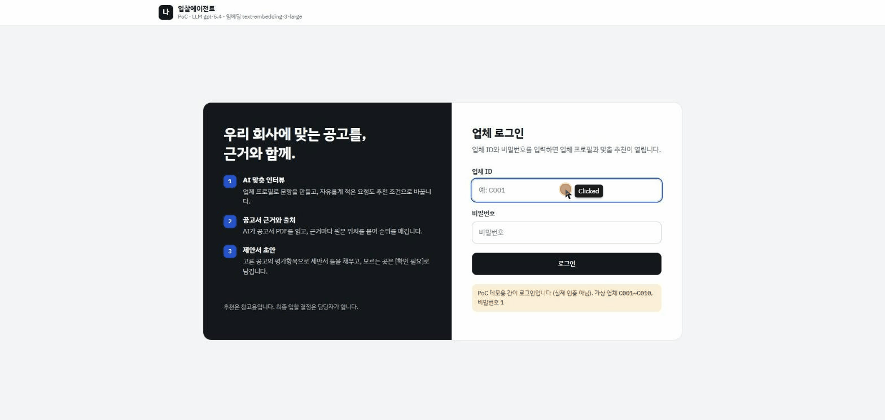
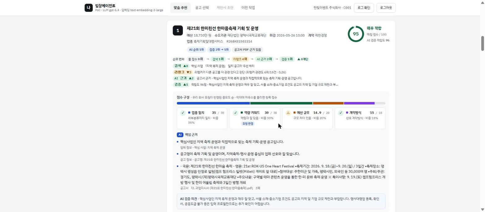
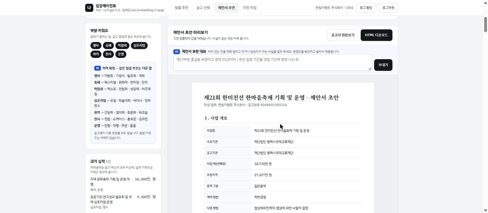

# Nara-AI-Bid — 나라장터 AI 입찰 어시스턴트

업체 프로필을 보고 나라장터 공고 중에서 참가 자격이 되는 공고를 골라 근거와 함께 추천하고, 담당자가 고른 공고로 제안서 초안까지 써 주는 AI 에이전트 PoC입니다.



| 항목 | 내용 |
|---|---|
| 기간 | 8주 (2026-09-28 ~ 2026-11-22) |
| 형태 | 개인 프로젝트 (PoC) |
| 핵심 기술 | LangGraph, Azure OpenAI structured output, 하이브리드 검색(BM25·임베딩·RRF·리랭커), RAG, ToT, Self-Correction, MCP, pgvector, LangSmith, FastAPI |

## 결과 요약

- 실제 공고 443건에서 자격 필터, 의미 검색, 공고서 PDF 근거 순위, 검증을 차례로 거쳐 상위 10건을 근거와 함께 추천합니다. 한 번 추천하는 데 2~5분이 걸립니다.
- 추천 정확도는 Hit Rate@3 90%입니다. 업체 10곳 중 9곳에서 상위 3건 안에 맞는 공고가 들어왔고, 목표는 80%였습니다.
- 검증 서브에이전트를 붙인 뒤 부적격 공고를 아래로 내리는 비율이 0.64에서 1.00이 됐습니다. 플래그 정밀도와 재현율은 0.94, 1.00입니다.
- LangSmith 트레이스로 어느 단계에서 틀렸는지 찾아 고쳐 검색 nDCG@10을 0.870에서 0.892로 올렸습니다.
- 화면에 나오는 근거는 모두 출처를 확인한 것입니다. LLM이 쓴 인용은 PDF 원문과 맞춰 보고 통과한 것만 보여 줍니다.

---

## 1. 문제

입찰 담당자는 매일 올라오는 공고를 하나씩 열어 자격 조건을 확인합니다. 맞는 공고를 찾으면 제안서 골격도 처음부터 다시 써야 합니다.

## 2. 해결

```
맞춤 인터뷰 → 핵심 사업·검색 프롬프트 → 자격 필터 → 의미 검색·리랭크 → 근거 순위(RAG·ToT) → 추천 검증·자체 점검 → 체크리스트 → 제안서 초안
   HITL               HITL               규칙      BM25+dense+RRF        LLM 순위안 3개       서브에이전트             HITL          LLM
```

LLM이 업체 프로필을 보고 인터뷰 문항을 만들고, 이번에 찾을 핵심 사업과 검색 프롬프트를 제안합니다. 담당자는 그대로 쓰거나 고칠 수 있습니다.

그다음 공고를 단계별로 좁혀 상위 10건을 보여 줍니다. 공고마다 PDF 인용이나 필드 값 같은 근거가 붙고, 룰·검색·리랭크·AI 근거·검증을 거치며 순위가 어떻게 바뀌었는지와 그 이유도 함께 나옵니다.

최종 판단은 담당자 몫입니다. 인터뷰, 핵심 사업, 공고 확정(체크리스트) 세 곳에서 그래프가 멈추고 사람의 확인을 기다립니다.

| 추천 카드 | 제안서 초안 |
|---|---|
|  |  |

## 3. 주요 구현

### 자격 필터와 의미 검색 분리
업종, 지역, 예산, 중소기업 제한은 LLM에 맡기지 않고 규칙(H1~H6)으로 거릅니다. 의미 검색은 이 필터를 통과한 공고에만 씁니다.

### 하이브리드 검색과 2단계 RAG
1단계에서는 공고 메타데이터 문장을 BM25(kiwipiepy)와 임베딩으로 찾고, 룰 순위까지 RRF로 합칩니다. 검색 문장은 절 단위로 나눠 리랭크합니다.

2단계에서는 상위 공고의 PDF만 조항 구조대로 잘라 pgvector(HNSW)에 넣고, LLM이 이 청크를 읽고 순위와 근거를 씁니다. PDF 전체를 미리 임베딩하지 않고 필요한 공고만 처리해서 비용과 시간을 아꼈습니다.

### ToT: 순위안 여러 개 중 고르기
근거 순위 단계에서 관점이 다른 순위안 세 개를 동시에 만듭니다. 기본, 실적 유사도 우선, 과업 적합도 우선입니다. 참가자격을 가장 먼저 보는 규칙은 세 안 모두 같고, 그다음 무엇을 더 무겁게 볼지만 다릅니다.

검증 단계는 공고 10건을 한 번만 평가합니다. 공고별 자격 문제와 적합도는 순서와 상관이 없으니, 이 결과 하나로 세 안을 모두 점검할 수 있습니다. 불통과가 가장 적은 안을 고르고, 같으면 상위 3건의 적합도 합이 큰 안을 고릅니다. 그래서 늘어나는 LLM 호출은 순위 단계의 2회뿐이고, 이마저 병렬로 돌립니다.

### Self-Correction: 자체 점검과 비평 재순위
검증 결과와 순위가 어긋나면 그 내용을 비평 프롬프트로 만들어 순위 단계로 돌려보냅니다. 재순위는 최대 2회까지 합니다. 어긋남으로 보는 경우는 세 가지입니다.

- 검증이 출처까지 확인한 자격 문제를 순위 단계가 놓친 경우
- 순위 단계가 쓴 근거가 원문 대조에서 하나도 남지 않은 경우
- 검증 적합도가 20점 이상 높은 공고가 순위에서 더 아래에 있는 경우

두 번을 다 써도 통과하지 못하면 불통과가 가장 적었던 회차의 결과를 씁니다.

### 환각 방지
LLM이 쓴 인용문은 PDF 원문과 맞춰 보고, 원문에 없으면 버립니다. 제안서 초안에서도 근거가 없는 칸은 지어내지 않고 `[확인 필요]`로 남긴 뒤 대화로 채웁니다.

### MCP 서버
웹 화면이 쓰는 추천·규칙·검색 함수를 MCP 도구 6개로 열었습니다. 업체 목록, 공고 추천, 자격 확인, 공고 상세, 공고서 근거 검색, 체크리스트입니다. Claude Desktop 같은 MCP 클라이언트에 등록하면 "C003 업체가 넣을 만한 공고 찾아줘"처럼 대화로 부를 수 있습니다. 판단은 클라이언트 쪽 LLM이 하고, 서버는 데이터와 규칙 결과만 돌려줍니다.

### 단계별 폴백
LLM 키, 임베딩, 벡터 DB 중 무엇이 빠져도 룰·BM25·기본값으로 대신해서 추천이 멈추지 않습니다. 어느 단계가 대체됐거나 실패했는지는 실행 로그 팝업에서 바로 보입니다. pytest 122건은 실제 LLM을 부르지 않고 돌아갑니다.

## 4. 문제 해결 사례

| 문제 | 시도 | 결과 |
|---|---|---|
| 검증 에이전트가 부적격 공고의 절반을 놓쳤다 (재현율 0.54) | 프롬프트보다 입력 근거를 의심했다. 참가자격 섹션 청크를 먼저 넣고, 원문·프로필과 맞춰 본 issue만 인정했다 | 재현율 0.97 (정답셋 50건) |
| 정답셋을 믿어도 되는지 확신이 없었다 | 일부러 엉터리 검증기(아무것도 안 함, 무작위, 라벨 반전)를 만들어 같은 지표로 쟀다 | 무조치 0.50~0.64, 라벨 반전 0.09. 정답셋이 좋은 검증과 나쁜 검증을 가려낸다는 걸 확인 |
| 재순위 루프가 정답셋 라벨로 통과 여부를 판정하고 있었다 | 라벨이 없는 실제 공고에서는 루프가 돌지 않고, 비평에 정답 사유가 들어가 같은 정답셋으로 잰 KPI가 부풀 수 있었다. 판정 기준을 순위 단계와 검증 결과의 비교로 바꿨다 | 라벨 없는 공고에서도 루프가 돌고, 비평 프롬프트에 정답이 들어가지 않는다 |
| 검색 품질이 업체마다 들쭉날쭉했다 | LangSmith 트레이스로 라벨 공고마다 필터, 검색 누락, 리랭크 밀림, 자격 검증 중 어디서 틀렸는지 자동으로 판정했다 | nDCG@10 0.870 → 0.892, P@10 0.93 → 0.95 |
| ToT 순위안을 늘리면 호출 비용이 세 배가 될 것 같았다 | 순위안끼리 후보 공고 10건이 같다는 점에 착안해 검증은 한 번만 돌리고 그 결과로 안마다 점검했다 | 추가 호출은 순위 단계 2회. 실측에서 상위 2건은 같고 3~10위 순서가 안마다 달랐다 |
| PDF 본문을 1단계 검색에 넣으면 나아질지 궁금했다 | `BODY_SEARCH` 옵션을 만들어 쟀다 | nDCG 0.904 → 0.908로 거의 차이가 없어 기본값은 껐다 |
| 500자 고정 청킹이 조항을 중간에서 잘랐다 | 조항 기호를 기준으로 300~800자로 자르고 상투 문구를 뺐다 | 근거 인용이 조항 단위로 깔끔하게 나온다 |

## 5. KPI 달성도

| KPI | 목표 | 실측 | 판정 |
|---|---|---|---|
| 추천 정확도 | Hit Rate@3 80% | 90% (10곳 중 9곳) | 달성 (잠정) |
| 추천 정확도 | Precision@3 0.67 | 검증 전 0.60, 검증 후 0.633 | 미달. 이 표본의 이론 상한 0.667의 95% |
| 자격 필터 정확성 | 통과 공고 중 부적격 0건 | 50건 중 13건 | 미달. 검증 단계에서 13건 모두 아래로 내림 |
| 근거 설명 가능성 | 출처 확인 95% | 화면 근거 100% | 달성 |
| 초안 근거성 | 없는 사실 0건 | 근거 없는 업체 사실 0건 (초안 1건) | 표본 충족 |
| 시간 단축 | 50% 이상 | 시스템 처리 2~5분 (11/14 실측 107~304초) | 수작업과 비교 측정 예정 |

시간을 뺀 수치는 11/11에 ToT와 자체 점검을 넣기 전 버전으로 잰 값입니다. 측정 기준과 버전별 수치는 [7번 문서](docs/7.E2E서비스개발.md) 2절에 있습니다.

## 6. 한계와 다음 단계

- 평가 규모가 작습니다. 정답셋은 50건이고 담당자 최종 확인 전이며, 업체도 가상 10곳입니다. ToT와 자체 점검을 넣은 지금 버전으로 KPI를 다시 재야 합니다.
- 규칙만으로는 공고서 본문에 적힌 인증·등록 같은 자격 조건을 다 잡지 못해서 검증 단계가 메웁니다. 다음에는 공고서 자격 조건 자체를 구조화하려고 합니다.
- 추천 시간이 재순위 횟수와 Azure 응답 속도에 따라 2분에서 5분까지 벌어집니다. 재순위 횟수는 `VERIFY_MAX_RETRY`로 줄일 수 있습니다.
- ToT 순위안끼리 상위권 차이가 아직 작습니다. 관점 문구를 더 다르게 쓰거나 안마다 temperature를 다르게 주는 실험이 남았습니다.
- 같은 요청에도 LLM 순위 판단은 조금씩 달라질 수 있습니다. 검색 문장은 캐시로 고정해 두었습니다.
- 운영으로 가려면 조달청 API 증분 수집, 야간 임베딩, 공고 벡터의 pgvector 이전, HWP 파싱, 동시 사용자 부하 테스트가 필요합니다. MCP 쪽은 외부 MCP 서버(조달청 API 등)를 붙이는 클라이언트 기능으로 넓힐 수 있습니다.

## 7. 기술 스택

| 구분 | 기술 |
|---|---|
| LLM·Agent | Azure OpenAI gpt-5.4 (gpt-4.1에서 교체, structured output), LangGraph, LangChain, LangSmith |
| 에이전트 기법 | ToT(순위안 비교), Self-Correction(자체 점검·비평 재순위), 검증 서브에이전트, HITL |
| MCP | MCP Python SDK 2.x, stdio 서버, 도구 6개 |
| 검색 | BM25(kiwipiepy), Azure text-embedding-3-large / BGE-M3, RRF, bge-reranker-v2-m3 |
| 데이터 | PostgreSQL 16 + pgvector (Docker), SQLite, PyMuPDF |
| 서버·화면 | FastAPI, Jinja2, SSE, 단일 HTML |
| 개발 | Python 3.11, uv, pytest |

실행 방법은 [README](README.md#실행)에 있습니다.
