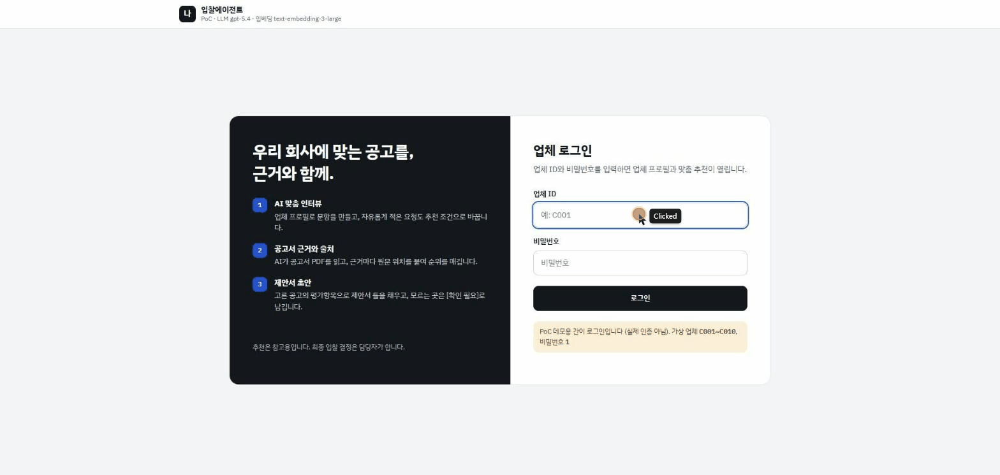
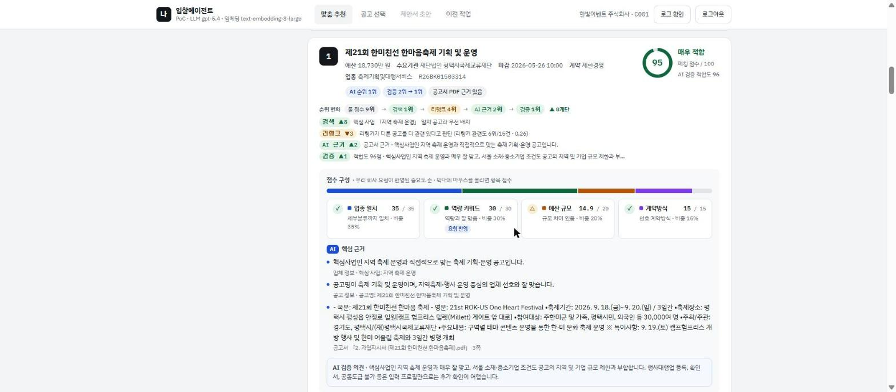
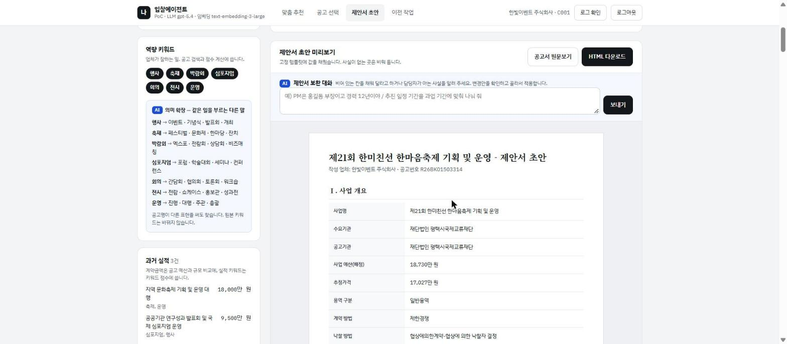

# 입찰에이전트 PoC

업체 정보를 넣으면 나라장터 용역 공고 중 참여할 만한 공고를 골라 주고, 고른 공고의 제안서 초안까지 써 주는 PoC입니다.



## 개요

입찰 담당자는 매일 올라오는 공고를 하나씩 열어 자격이 되는지 보고, 맞는 공고를 찾으면 제안서 골격을 처음부터 다시 씁니다. 이 반복 작업을 줄이려고 만들었습니다.

먼저 업체 프로필로 짧은 인터뷰를 하고, 이번에 찾을 핵심 사업과 검색 프롬프트를 정합니다. 그다음 수집한 공고 데이터에서 참가 자격이 되는 공고를 추리고, 의미 검색과 리랭크, 공고서 PDF 근거 순위(RAG), 추천 검증을 거쳐 업체에 맞는 공고를 근거와 출처를 붙여 추천합니다. 담당자가 체크리스트를 확인하고 공고를 확정하면 업체 문서를 바탕으로 제안서 초안을 씁니다. 판단은 처음부터 끝까지 담당자가 합니다(HITL).

| 추천 카드 | 제안서 초안 |
|---|---|
|  |  |

## KPI

| 구분 | 지표 | 목표 | 현재 (11/16 측정) | 판정 |
|---|---|---|---|---|
| 추천 | Hit Rate@3 | 80% 이상 | 80% (10곳 중 8곳) | 달성 |
| 추천 | Precision@3 | 0.67 이상 | 0.567 (이 표본의 상한 0.600) | 미달 |
| 추천 | 자격 필터 통과 공고 중 부적격 | 0건 | 50건 중 19건. 검증이 약 17건을 '자격 확인 필요'로 분리하고 약 2건이 남음 | 미달 |
| 추천 | 근거 출처 확인 비율 | 95% 이상 | 화면 근거 100% | 달성 |
| 업무 | 공고 탐색·검토 시간 | 50% 이상 단축 | 2.5~5시간 → 약 35~60분, 60~88% 단축 (시스템 실측 + 사람 확인 시간 추정) | 달성 |
| 제안서 | 업체 프로필·문서·공고서에 없는 사실 기재 | 0건 | 0건 (초안 3건, AI 대조 + 담당자 확인) | 달성 |
| 보조 | 자격 검증 F1 | 목표 없음 | 0.91 (정밀도 0.93 · 재현율 0.90, 11/17 `eval_verify.py` 3회 평균) | 참고 지표 |

추천 KPI는 정답셋 50건(업체 10곳 × 상위 5건)에 현재 검증 코드를 3회 적용한 평균입니다. 정답셋은 담당자가 확인한 뒤, AI가 회사소개서의 면허·직접생산 목록과 공고서 자격 조항을 다시 대조해 6건을 부적격으로 고쳤습니다. 측정 기준과 버전별 수치는 [7번 문서](docs/7.E2E서비스개발.md) 2·3절에 있습니다.

단계별로 따로 잰 수치도 있습니다. 검증 에이전트는 같은 정답셋에서 부적격 공고를 아래로 내리는 비율이 0.765에서 0.981이 됐고, 플래그 정밀도와 재현율은 0.93, 0.88입니다. 둘의 조화평균인 F1은 11/17에 평가 스크립트로 3회 다시 잰 평균이 0.91입니다(그때 정밀도 0.93, 재현율 0.90). F1은 최종 정리 때 추가한 보조 지표라 목표를 두지 않았고, 추천 순위는 라벨이 상위 5건에만 있어 재현율을 정의할 수 없으므로 검증 단계에만 씁니다. 회사소개서의 보유 면허 목록을 검증에 넣기 전에는 재현율이 0.70이었습니다. 평가 방법은 [6번 문서](docs/6.테스트및고도화.md) 1-5절에 있습니다. 검색은 LangSmith 트레이스로 실패 원인을 찾아 고친 뒤 nDCG@10이 0.870에서 0.892로, P@10이 0.93에서 0.95로 올랐습니다.

## 추천 흐름

LangGraph 그래프 하나(`backend/graphs/proposal.py`)를 규칙 기반 Supervisor가 단계별로 돌립니다. HITL 지점에서는 멈춰서 담당자 입력을 기다렸다가 이어 갑니다.

| 단계 | 하는 일 | 코드 |
|---|---|---|
| ⓪ 맞춤 인터뷰 (HITL) | 업체 정보로 문항과 선택지를 만든다. 자유 입력도 선택지와 같은 방식으로 해석한다 | `tools/interview.py` |
| ① 핵심 사업·검색 프롬프트 (HITL) | 역량, 실적, 인터뷰 답을 보고 핵심 사업 후보와 후보별 검색 프롬프트를 제안한다. 담당자가 고르거나 직접 쓰고, 프롬프트를 고친 뒤 추천을 시작한다 | `tools/interview.py` |
| ② 자격 필터 | PDF 보유, 업종, 참가 제한, 지역, 예산(H1~H6)과 인터뷰 조건으로 거른다 | `tools/rules.py` |
| ③ 소프트 점수 | S1 업종, S2 역량 키워드(문자열·의미 유사도, 핵심 사업 포함), S3 예산, S4 계약방식 | `tools/rules.py` |
| ④ 의미 검색·리랭크 | 검색 프롬프트로 dense, BM25, 룰 순위를 RRF로 합치고, 검색 문장을 절 단위로 나눠 리랭크한다(절별 최댓값). 핵심 사업과 맞는 공고를 앞으로 올리고 상위 10건을 남긴다 | `graphs/recommend.py`, `tools/search.py` |
| ⑤ 근거 순위 (RAG·ToT) | 10건의 공고서 청크를 하이브리드 검색하고 LLM이 순위와 근거를 쓴다. 인용문은 원문과 맞춰 본다. 관점이 다른 순위안 3개(기본, 실적 유사도 우선, 과업 적합도 우선)를 동시에 만든다(`TOT_BRANCHES`) | `agents/rag.py` |
| ⑥ 추천 검증 | 검증 서브에이전트가 상위 10건(`VERIFY_TOP_N`)을 다시 본다. 공고서 자격 조항을 업체 소재지·중소기업 여부·업종·금액, 회사소개서의 보유 면허·직접생산 목록과 대조한다. 출처까지 확인된 자격 문제(issue)가 있는 공고는 추천 건수에서 빼고 '자격 확인 필요' 영역으로 보낸다. 이어서 ⑤의 순위가 검증 결과와 어긋나지 않는지 자체 점검한다. 순위안이 여러 개면 검증은 한 번만 돌리고 안마다 점검해 불통과가 가장 적은 안을 고른다. 그래도 불통과면 어긋난 내용을 비평 프롬프트로 붙여 ⑤를 다시 돌린다(`VERIFY_MAX_RETRY`, 최대 2회) | `agents/verify.py` |
| ⑦ 확인 체크리스트 (HITL) | 공고 조건, 공고서에서 뽑은 자격·서류·일정, 검증 issue를 보여 준다. 전부 체크해야 확정되고, 자격 확인 필요 공고는 issue마다 '해당 없음' 사유를 적어야 확정된다 | `tools/checklist.py` |
| ⑧ 제안서 초안 | 평가항목과 배점을 뽑고, 템플릿에 섹션별로 LLM이 업체 문서를 근거로 쓴다. 칸 단위로 대화하며 고칠 수 있고, 공고서 PDF를 옆에 띄워 볼 수 있다 | `tools/proposal*.py` |

알아 두면 좋은 동작이 몇 가지 있습니다.

- 핵심 사업은 가장 먼저 보는 기준이지만 공고를 걸러 내지는 않습니다. 안 맞는 공고도 뒤쪽에 남습니다. 예산·지역·제외어 필터는 인터뷰 답을 따르고, 검색 프롬프트를 고쳐도 바뀌지 않습니다.
- ⑤는 참가자격 충돌이 없는지를 가장 먼저 보고, 그다음 핵심 사업 일치, 검색 프롬프트·인터뷰 답·역량·실적을 종합한 적합도, 예산 순으로 봅니다.
- 핵심 사업 일치는 핵심 사업의 단어가 공고명이나 분류명에 들어 있는지로 판단합니다. `운영`, `지역` 같은 일반어는 뺍니다. 표현만 다른 공고는 의미 검색과 LLM 순위 판단에서 잡습니다.
- LLM, 임베딩, 벡터 DB가 없거나 출력 검증에 실패하면 그 단계는 룰·BM25·기본값으로 대신합니다. 이때 핵심 사업 후보는 역량·실적 키워드로 채웁니다.
- LLM이 만든 검색 문장은 업체 프로필별로 `data/query_cache.json`에 저장해 둡니다. 실행할 때마다 결과가 흔들리지 않게 하려는 것입니다.
- 추천 카드에서는 매칭 점수(0~100)와 등급(매우 적합·적합·보통·낮음), 공고 요약(예산·수요기관·마감·계약방식·업종·지역 제한), 업체 가중치 순 점수 구성, 자격·검증 확인 사항, 핵심 근거 3개를 펼치지 않고 볼 수 있습니다. 룰, 검색, 리랭크, AI 근거, 검증을 거치며 순위가 어떻게 바뀌었는지도 이유와 함께 한 줄씩 나옵니다. 상세 근거, 점수 계산, 검색 점수는 접어 두었습니다.
- 제안서에서 근거를 찾지 못한 칸은 지어내지 않고 `[확인 필요]`나 `[AI 초안·검토 필요]`로 남깁니다.

## 기술 스택

| 구분 | 기술 |
|---|---|
| LLM | Azure OpenAI (structured output). `AZURE_OPENAI_CHAT_DEPLOYMENT`에 넣은 배포를 쓴다. 측정은 gpt-5.4로 했고 `.env.example` 기본값은 gpt-4.1. gpt-6.1-sol과 비교해 gpt-5.4를 유지했다(검증 플래그 정밀도 0.944 vs 0.773, 약 2.7배 빠름). gpt-6 계열 추론 모델은 temperature를 거부하므로 `LLM_TEMPERATURE`를 비워 둔다 |
| Agent | LangGraph, LangChain, LangSmith 추적. ToT(순위안 비교), Self-Correction(자체 점검과 비평 재순위) |
| MCP | MCP Python SDK 2.x (`MCPServer`, stdio). 자격 판정, 공고서 요건 추출, 인용 원문 대조를 외부 AI 클라이언트용 도구 3개로 연다 |
| 검색 | BM25(kiwipiepy), 임베딩(Azure text-embedding-3-large 1024차원 또는 로컬 BGE-M3), RRF, bge-reranker-v2-m3 |
| 벡터 DB | PostgreSQL 16 + pgvector(Docker). 1단계 공고 검색용 공고 문서 벡터(`tender_docs`)와 공고서·업체 문서 청크 벡터(`tender_chunks`)를 HNSW로 저장한다. 공고 검색 유사도도 DB 안에서 계산하고, 메모리·파일 벡터 캐시는 쓰지 않는다 |
| PDF | PyMuPDF, 조항 구조 기준 300~800자 청킹 |
| 서버·DB | FastAPI, Jinja2, SSE, SQLite(업체·이력) |
| 프론트 | 단일 HTML (`frontend/index.html`) |
| 기타 | Python 3.11, uv, pytest 123건 |

## 데이터

| 데이터 | 구성 |
|---|---|
| 공고 | 2026년 5월 실제 용역 공고 500건 중 유효 443건, PDF가 있는 공고 410건 ([수집 방법](공고데이터수집방법.md)) |
| 업체 | 가상 업체 10곳(`data/companies/`)과 회사소개서(`data/companies/docs/`) |
| 지역 제한 | 허용 시·도를 직접 매핑(`data/region_limits.csv`) |
| 평가 | 검증 정답셋 50건(`data/eval/verify_gold.json`), 담당자 확인 + AI 대조 완료 |

## 폴더 구조

```
backend/
  server.py     FastAPI (화면·API·실행 로그·추천 진행·제안서 대화 SSE)
  mcp_server.py MCP 서버 (도구 3개)
  graphs/       Supervisor 전체 그래프, 추천 Worker 서브그래프
  agents/       interview · rag · verify · selection · draft · state
  tools/        interview · keyword_profile · rules · search · retrieval · pdf · evidence · checklist · llm
                proposal · proposal_writer · proposal_chat · company_docs · activity(실행 로그) · loaders
  db/           SQLite(repository.py), pgvector(vector_store.py)
  templates/    proposal.html.j2
frontend/       index.html
scripts/        run_demo · seed_companies · check_env · validate_data · warm_chunk_vectors
                eval_verify · eval_body · eval_search · diagnose
tests/          pytest
data/           공고·업체·업체 문서·평가셋·검색 문장 캐시(query_cache.json)
assets/         데모 GIF, 화면 캡처
docs/           단계별 문서 1~7
```

## 실행

```powershell
uv sync                                        # 기본 설치 (키워드 검색 모드)
uv sync --extra rag                            # (선택) BGE-M3·리랭커·pgvector 클라이언트
docker compose up -d                           # (선택) 청크 벡터 DB, Docker Desktop을 먼저 켤 것
uv run python scripts/warm_chunk_vectors.py --all  # (선택) 공고 청크 벡터 미리 계산
uv run python scripts/seed_companies.py        # 업체 → data/app.db
uv run uvicorn backend.server:app --port 8000  # http://localhost:8000 (C001~C010 / 비밀번호 1)
uv run pytest                                  # 테스트 (실제 LLM 호출 없음)
```

`.env.example`을 `.env`로 복사하고 Azure 키를 넣으면 AI 단계가 켜집니다. 키가 없으면 룰 모드로 돌아갑니다.

`EMBEDDING_PROVIDER`는 `keyword`(기본), `azure`(임베딩 API), `bge`(로컬, `--extra rag` 필요) 중에서 고릅니다. 리랭크는 `azure`나 `bge`일 때만 시도하고, `--extra rag`가 없거나 실패하면 건너뜁니다.

벡터 DB에 연결하지 못해도 추천은 그대로 진행됩니다. 공고 검색은 BM25·룰 순위로, 청크 검색은 BM25·키워드로 하고, 30초마다 다시 연결을 시도합니다. 의미 검색을 쓰려면 Docker를 켜 두어야 합니다. 공고 문서 벡터는 첫 검색 때 없는 것만 계산해 DB에 넣습니다.

로그인한 뒤 오른쪽 위 [로그 확인]을 누르면 실행 로그 팝업이 뜹니다. 주요 기능과 LLM·RAG·벡터 DB·임베딩·리랭크 호출이 2초 간격으로 올라오고, 룰·BM25로 넘어간 단계는 `대체`, 실패한 단계는 `오류`로 표시됩니다. 서버 메모리에 최근 300줄만 들고 있어서 재시작하면 지워집니다.

자주 바꾸는 설정은 이렇습니다.

- `VERIFY_MAX_RETRY` (0~2, 기본 2): 자체 점검에서 걸렸을 때 ⑤를 다시 돌리는 횟수입니다. 검증이 찾은 자격 문제를 ⑤가 놓쳤을 때(자격 누락), ⑤의 근거가 원문 대조에서 전부 떨어졌을 때(근거 미확인), 검증 적합도가 20점 이상 높은 공고가 ⑤에서 더 아래일 때(순위 역전) 걸립니다. 재시도를 다 써도 통과하지 못하면 불통과가 가장 적었던 결과를 씁니다. 정답셋은 이 판정에 쓰지 않고 평가 스크립트에서만 씁니다.
- `TOT_BRANCHES` (1~3, 기본 3): ⑤에서 만들 순위안 수입니다. 1이면 ToT를 끄고 순위안 하나로 갑니다. 순위안은 병렬로 부르고 검증은 한 번만 돌리기 때문에 늘어나는 LLM 호출은 ⑤의 2회뿐입니다. 어떤 안이 선택됐는지는 실행 로그와 추천 검증 단계의 "순위안 비교"에서 볼 수 있습니다.
- `BODY_SEARCH=1`: 1단계 검색에 PDF 본문 순위를 더합니다. 재 보니 거의 차이가 없어서(nDCG 0.904 → 0.908) 기본은 꺼 두었습니다.
- LangSmith: `.env`에 `LANGSMITH_TRACING=true`와 키를 넣으면 추천 한 번이 트레이스 하나로 남습니다. 하이브리드 검색의 단계별 순위와 리랭크 전후 순위도 같이 찍힙니다.

평가와 진단에는 스크립트 두 개를 씁니다. `scripts/eval_search.py`는 검색 nDCG와 P@10을 재고, `scripts/diagnose.py`는 라벨 공고마다 필터, 검색 누락, 리랭크 밀림, 자격 검증 중 어디서 틀렸는지 판정해서 트레이스 링크와 함께 보여 줍니다.

## MCP 서버

웹 화면이 쓰는 자격 규칙, 조항 청킹, 원문 대조 함수를 MCP 도구 3개로 열어 두었습니다. 등록된 업체ID가 아니라 호출하는 쪽의 업체 프로필이나 공고서 PDF를 그대로 받기 때문에, 이 프로젝트 데이터 밖에서도 쓸 수 있습니다. Claude Desktop 같은 MCP 클라이언트에 등록하면 "이 공고서에서 참가 자격 뽑아줘", "제안서에 쓴 이 문장이 공고서에 진짜 있어?"처럼 대화로 부를 수 있습니다. 판단과 요약은 클라이언트 쪽 LLM이 합니다.

```powershell
uv sync --extra mcp                                # rag도 쓰려면 uv sync --extra rag --extra mcp
uv run --extra mcp python -m backend.mcp_server    # stdio 서버
```

| 도구 | 하는 일 |
|---|---|
| `check_eligibility(company, tender_no)` | 넘겨받은 업체 프로필(소재지, 중소기업 여부, 업종, 참여 가능 금액)로 공고의 규칙 H1~H6 통과 여부와 걸린 사유를 판정. 공고는 2026-05 나라장터 스냅샷 기준 |
| `extract_requirements(pdf)` | 공고서 PDF(경로 또는 URL)에서 참가자격·실적·제출서류·일정을 쪽수와 원문 인용과 함께 추출. 인용이 원문에 없는 항목은 버림. LLM이 없으면 관련 조항 원문만 |
| `verify_quote(quote, pdf, page)` | 인용문이 공고서 원문에 있는지 공백을 무시하고 대조. 줄임표로 줄인 인용은 조각이 같은 조항에 있어야 통과. 다른 AI가 쓴 제안서·요약의 환각 검사용 |

Claude Desktop 설정(`claude_desktop_config.json`)은 이렇게 넣으면 됩니다.

```json
{"mcpServers": {"nara-bid": {"command": "uv",
  "args": ["--directory", "<프로젝트 경로>", "run", "--extra", "mcp", "python", "-m", "backend.mcp_server"]}}}
```

## 범위 밖

조달청 공고 API 실시간 연동과 마감일 필터, HWP 파싱, 완성형 제안서와 자동 제출, 낙찰가 예측, 실제 인증은 이번 범위에 넣지 않았습니다.

## 문서

[1. 역량·기술스택](docs/1.역량및기술스택확인.md) · [2. 문제정의·서비스계획](docs/2.문제정의및서비스계획.md) · [3. 시나리오](docs/3.시나리오수립.md) · [4. 상세설계·개발환경](docs/4.상세설계및개발환경구축.md) · [5. POC 모듈](docs/5.POC%20모듈%20구현.md) · [6. 테스트·고도화](docs/6.테스트및고도화.md) · [7. E2E 서비스](docs/7.E2E서비스개발.md) · [포트폴리오 요약](PORTFOLIO.md)
